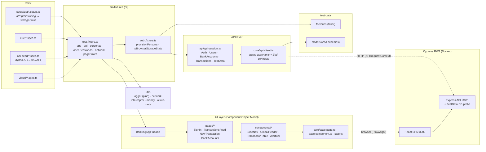
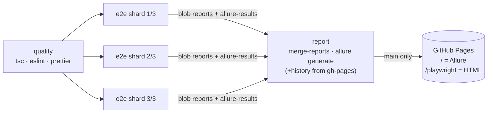

# Playwright Enterprise E2E Framework

[](https://github.com/automatish/playwright-enterprise-framework-/actions/workflows/e2e-ci.yml)
[](https://automatish.github.io/playwright-enterprise-framework-/)

A production-grade **Playwright + TypeScript** test automation framework, built against a real full-stack fintech application: the **[Cypress Real World App (RWA)](https://github.com/cypress-io/cypress-realworld-app)** (React, Express, lowdb, Passport sessions). It covers payments, balances, bank accounts, notifications and real-time feeds.

The design aims for **deterministic, parallel-safe, zero-sleep tests** that read like business specifications and fail with evidence you can act on.

|               |                                                                                                                |
| ------------- | -------------------------------------------------------------------------------------------------------------- |
| **Language**  | TypeScript 6, `strict` + `noUncheckedIndexedAccess` + `exactOptionalPropertyTypes`, zero `any` (lint-enforced) |
| **Runner**    | Playwright Test 1.63 (Chromium by default; Firefox/WebKit via `BROWSERS`)                                      |
| **Patterns**  | Component Object Model, fixture-based DI, API-first arrange, contract-validated API client                     |
| **Data**      | `@faker-js/faker` factories, Zod data contracts, per-test isolated personas                                    |
| **Reporting** | Allure (steps, severity, epics, links, history trends) + Playwright HTML + console / GitHub annotations        |
| **CI/CD**     | GitHub Actions: quality gate, 3-way sharding, merged reports, Allure on GitHub Pages                           |
| **Infra**     | Docker Compose: pinned RWA build + pinned Playwright runner image (pixel-identical screenshots)                |

---

## Quick start

### Option A: one command, fully containerised (recommended)

```bash
docker compose run --rm tests
```

Compose builds RWA from a pinned upstream commit, waits for its health check, and runs the whole suite in `mcr.microsoft.com/playwright:v1.63.0-noble`. Reports appear in `./reports`.

```bash
docker compose run --rm tests --project=e2e-chromium --grep @smoke   # any Playwright CLI args
docker compose --profile report up allure                            # live Allure UI on :5050
```

### Option B: local Node, containerised app

```bash
npm ci
npx playwright install --with-deps chromium
npm run app:up            # docker compose up -d --wait rwa
npm test                  # every project: setup → e2e → visual
npm run report:allure     # needs Java 11+ (or use the compose "allure" profile)
npm run report:html
```

> RWA's front-end calls `http://localhost:3001` (hard-coded), so the app must be reachable on **localhost:3000 and :3001**. Compose publishes both ports, and the `tests` container shares the app's network namespace for the same reason.

| Script                             | Purpose                                                            |
| ---------------------------------- | ------------------------------------------------------------------ |
| `npm test`                         | Full run (setup, e2e, visual)                                      |
| `npm run test:e2e` / `test:visual` | A single project                                                   |
| `npm run test:visual:update`       | Re-baseline screenshots **inside the pinned Docker image**         |
| `npm run verify`                   | `tsc --noEmit` + ESLint (type-aware, Playwright plugin) + Prettier |

Configuration is validated at start-up with Zod (`src/config/env.config.ts`); see `.env.example`.

---

## Architecture



### CI pipeline



Each shard builds RWA and the runner image with BuildKit GHA layer caching, starts the app with `docker compose up --wait`, and runs `--shard=N/3`. The report job merges every shard into one Playwright HTML report and one Allure report. It restores `history/` from `gh-pages` first, so trend graphs carry across runs.

---

## Repository layout

```text
.
├── .github/workflows/e2e-ci.yml     # quality gate → 3 shards → merged reports → gh-pages
├── docker/rwa/Dockerfile            # RWA at a pinned commit, production (vite) build
├── docker-compose.yml               # rwa + tests runner + optional Allure UI
├── Dockerfile                       # headless runner (pinned Playwright image)
├── playwright.config.ts             # re-exports src/config/playwright.config.ts
├── src/
│   ├── config/                      # env.config.ts (Zod) · playwright.config.ts
│   ├── core/                        # base.page · base.component · api.client · step
│   ├── api/                         # domain API clients + ApiSession facade
│   ├── fixtures/                    # auth.fixture (session hydration) · test.fixture (DI)
│   ├── pages/
│   │   ├── auth/                    # SignInPage
│   │   ├── banking/                 # TransactionsFeed · NewTransaction (transfer) · BankAccounts
│   │   ├── components/              # SideNav · GlobalHeader · TransactionTable · AlertBar
│   │   └── banking-app.ts           # page-object graph facade
│   ├── test-data/{factories,models}
│   └── utils/                       # logger · network-interceptor · money · allure-meta
└── tests/
    ├── setup/                       # one-off API provisioning → .auth/user.json
    ├── e2e/                         # critical user journeys, resilience, auth
    ├── api-seed/                    # hybrid API → UI → API/DB tests
    └── visual/                      # screenshot regression (+ committed baselines)
```

---

## Test catalogue

| Spec                                 | What it proves                                                                                                                                                                                                                                                     | Technique                                                                             |
| ------------------------------------ | ------------------------------------------------------------------------------------------------------------------------------------------------------------------------------------------------------------------------------------------------------------------ | ------------------------------------------------------------------------------------- |
| `e2e/payment-flow.spec.ts`           | A signed-in user pays a contact. The payment appears in "Mine" with the correct sender, receiver, sign and amount, and the recipient is credited.                                                                                                                  | **Cached `storageState`** (no UI login), API-provisioned recipient, typed row parsing |
| `api-seed/transfer-hybrid.spec.ts`   | API seeds $1,000. The UI shows it and transfers $150. Business endpoints **and the raw DB** agree: one record, exact balances, money conserved.                                                                                                                    | **Hybrid API → UI → API/DB**, isolated personas                                       |
| `e2e/network-resilience.spec.ts`     | Feed survives **HTTP 500 / 503 / timeout / offline**: the shell stays usable, a safe empty state shows, and a user retry recovers once the network is back. Skeleton during a latency spike. Usable on **Slow 3G**. A payment during an outage **moves no money**. | `page.route` fault injection, CDP throttling, data-driven fault matrix                |
| `e2e/authentication.spec.ts`         | Route guard, valid sign-in, invalid password (message + no session).                                                                                                                                                                                               | The only UI logins in the suite                                                       |
| `e2e/bank-accounts.spec.ts`          | Link a bank account in the UI, verify it via API, soft-delete it.                                                                                                                                                                                                  | UI + API verification                                                                 |
| `visual/public-pages.visual.spec.ts` | Sign-in, validation state, bank-accounts page.                                                                                                                                                                                                                     | `toHaveScreenshot` with masks, baselines from the pinned image                        |

### Known product defect, tracked as an expected failure

`network-resilience.spec.ts › user is told the payment failed` is marked `test.fail()`. RWA shows an **optimistic "Transaction Submitted!" success toast** before `POST /transactions` resolves, and never reports a failure ([source](https://github.com/cypress-io/cypress-realworld-app/blob/0729f68ac220f7cda4ad09c5693dba11d7c532c6/src/components/TransactionCreateStepTwo.tsx#L116-L127)). The test asserts the _correct_ behaviour (an error toast). It reports as an expected failure today, and turns red the day the defect is fixed, which prompts removing the marker. Its companion test proves the part that matters most: **no money moves**.

---

## Engineering decisions

### Why Playwright over Cypress for this suite

| Concern                            | Playwright                                                                         | Cypress                                                                    |
| ---------------------------------- | ---------------------------------------------------------------------------------- | -------------------------------------------------------------------------- |
| Multi-tab / multi-user in one test | Native: multiple contexts (sender + recipient sessions in one test)                | One browser tab per test                                                   |
| Parallelism                        | Free, built in (workers + `--shard`)                                               | Paid orchestration for parallel / load balancing                           |
| Engines                            | Chromium, Firefox, WebKit from one API                                             | WebKit support is experimental                                             |
| Network control                    | `page.route` (fulfil / abort with net error codes / delay) **plus** CDP throttling | `cy.intercept`, no bandwidth throttling                                    |
| API testing                        | `APIRequestContext`: first-class, own cookie jars, traced                          | `cy.request`, shares the browser's cookies                                 |
| Language model                     | Plain `async/await`, so ordinary TypeScript composition and types                  | Chained command queue, harder to type and abstract                         |
| Debuggability                      | Trace Viewer (DOM snapshots, network, console, steps) as a CI artefact             | Excellent interactive time-travel; CI evidence is mostly video/screenshots |

Testing a Cypress demo app _with Playwright_ is deliberate. RWA is the most realistic open-source fintech SUT available, and its own Cypress suite is a useful baseline to compare against.

### `storageState` vs UI login: and how it works for an xstate SPA

A UI login costs seconds per test and makes every spec depend on the login form. Here **only `authentication.spec.ts` touches the login form**. Every other test starts authenticated.

RWA needs more than a cookie, though. The SPA never asks the server "who am I?" on boot. It restores a serialised **xstate auth-machine snapshot** from `localStorage.authState`. So a browser session is _cookie (server truth) + snapshot (client truth)_. `src/fixtures/auth.fixture.ts`:

1. logs in via `POST /login` with an isolated `APIRequestContext` to get the `connect.sid` cookie;
2. synthesises the `authorized` machine snapshot from the user returned by that same login;
3. writes both into a Playwright `storageState`.

The setup project does this once (`.auth/user.json`), then **smoke-checks it in a real browser** before any dependent test runs. Tests that mutate money use `personas.create()` + `openSessionAs()`, which apply the same technique to a brand-new user in well under a second, with no UI.

### Isolation model: shared read-only identity, private money

- **Primary persona** (from setup): for flows whose assertions don't depend on its exact balance.
- **Per-test personas**: every test that asserts exact balances provisions its own sender/recipient through the API. No test can see another test's money, so `fullyParallel`, `--repeat-each`, sharding and retries are all safe.
- Unique data is guaranteed by worker index + UUID suffixes (`test-data/factories/unique.ts`).
- The setup project re-seeds RWA once (`POST /testData/seed`) for a deterministic baseline (`RESET_DB_ON_START`).

### A pitfall worth knowing: `request.newContext()` inherits `storageState`

Inside the test runner, `request.newContext()` silently inherits the project's `use.storageState`. Early versions of this framework had every "isolated" API client starting with the **primary user's session cookie**. A persona's API login then **re-bound the shared server session to a different user**. The symptoms were flaky contact search, "self" showing in contact lists, and balances landing on the wrong account. `ApiClient.create()` now always passes an explicit empty `storageState`. The Playwright trace's network tab exposed the cause: request headers showed one `connect.sid` across all API calls.

### Anti-flake rules (lint-enforced where possible)

- No `waitForTimeout`, `networkidle` or `force: true` (`eslint-plugin-playwright` errors).
- Only web-first, auto-retrying assertions (`toHaveText`, `toBeVisible`, …) on UI state.
- Race-free API waits: `waitForResponse` is armed _before_ the triggering action (`BasePage.waitForApi`).
- Known app races are encoded once in page objects with an explanation. For example, RWA's users machine ignores a search issued while the initial `GET /users` is in flight, so `selectRecipient` waits for the first contacts to render.
- Every test fails on **uncaught page exceptions** (`pageErrors` auto-fixture): a crash is never "graceful degradation".
- Retries are on in CI only (2), where they show up as **flaky**, not hidden. Locally there are 0, for honest feedback.

### Locator strategy

Priority: `getByRole` → `getByLabel` / `getByPlaceholder` → `getByTestId` (RWA's `data-test`, configured with `testIdAttribute`) → scoped structural CSS (one documented case: the memo line, which has no hook). Components scope every locator to a root, so the same component works on any page.

### API client and data contracts

`ApiClient` asserts the expected status on every call and validates responses against **Zod contracts** (`test-data/models`). Backend drift fails at the exact call with a readable diff. The Allure category _"Contract / API drift"_ groups those failures. The `/testData` router is used as an **independent DB oracle** in hybrid tests, so the suite asserts what is _persisted_, not just what an endpoint chooses to return.

### Reporting

- `test.step` (via `core/step.ts`, `box: true`) is the single source of step data. allure-playwright turns it into Allure steps, and the HTML report and trace show the same tree.
- `describeTest()` applies epic / feature / story / severity / owner / TMS / issue links uniformly. Tags (`@smoke`, `@critical`, …) become Allure tags and `--grep` filters.
- Screenshots, video and traces are **retained only on failure**.
- Allure categories classify failures: known defects, contract drift, infrastructure, visual regressions.

### Visual testing

Font rendering differs between OSes, so baselines are only generated in the pinned runner image (`npm run test:visual:update`). Dynamic regions (names, account numbers) are masked, and balances are fixed by seeding the persona's balance.

---

## Alternative targets

The framework layers (`core`, `fixtures`, `utils`, reporting, CI) are application-agnostic. Pointing it at another SUT means adding page objects, an `ApiSession` and an auth hydrator for that app:

- **SauceDemo / Conduit**: zero-install public targets. Swap `BASE_URL` and add their page objects. Conduit's JWT-in-localStorage auth maps directly onto `toBrowserStorageState`.
- **ParaBank**: loan requests and wire transfers. Its SOAP/REST API slots into `ApiClient` with new Zod contracts.

Only the RWA implementation ships and is verified in this repository.

---

## Conventions

- Specs talk in domain terms (`app.newTransaction.pay(...)`). Raw locators belong in page/component objects.
- Arrange through the API, act through the UI, assert in the UI **and** at the API/DB.
- Money is always integer cents (`utils/money.ts`). UI strings are produced by the same formatter the assertions use.
- Every spec calls `describeTest()` and carries at least one tag.
